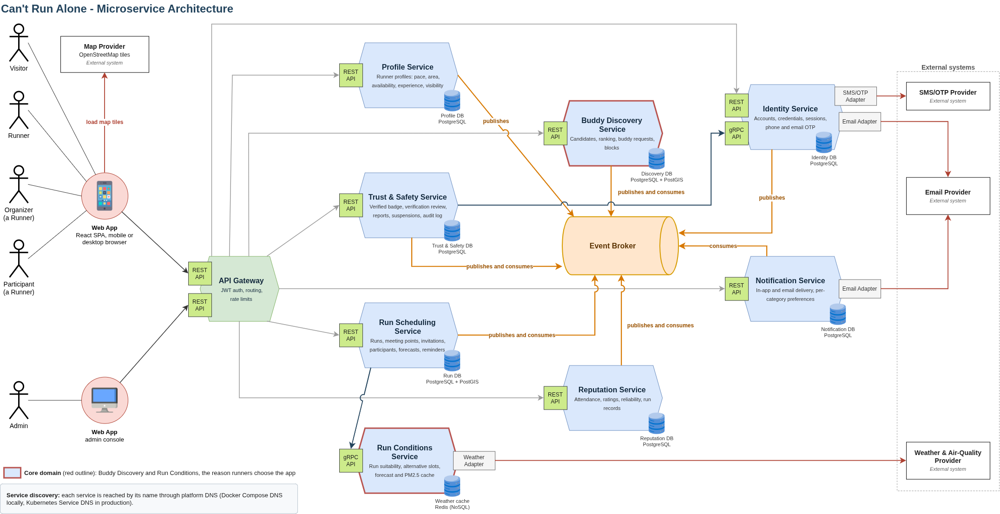
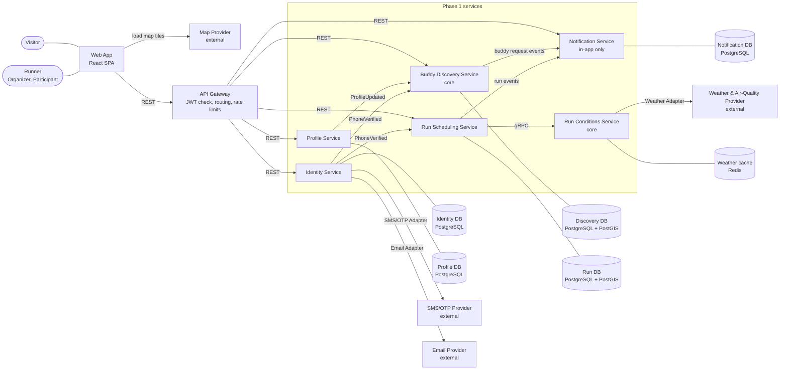

# Microservice architecture

Can't Run Alone is built as microservices ([ADR-0008](../adr/0008-use-a-microservices-architecture.md)): one service per bounded context, each owning its data, behind one API gateway. This folder holds the as-built architecture views and the Deliverable 2 design (the target architecture).

## As built (final presentation)

| File | What it is |
| --- | --- |
| [goals-and-constraints.md](goals-and-constraints.md) | Architectural goals, constraints and key decisions |
| [c4-level-1-system-context.md](c4-level-1-system-context.md) | C4 Level 1: users and external systems |
| [c4-level-2-container.md](c4-level-2-container.md) | C4 Level 2: services, databases, broker and protocols as built |
| [sequence-buddy-request.md](sequence-buddy-request.md) | Sequence diagram for the buddy request scenario |
| [deployment.md](deployment.md) | Deployment overview and service discovery |
| [images/](images/) | PNG exports of the diagrams above, for slides |

## Deliverable 2 design (target)

The rest of this page describes the design submitted for Deliverable 2. Where the build differs, [c4-level-2-container.md](c4-level-2-container.md) lists the changes.

| File | What it is |
| --- | --- |
| [service-operations-collaborators.md](service-operations-collaborators.md) | Target Service / Operations / Collaborators table, as submitted for Deliverable 2 |
| [architecture-notes.md](architecture-notes.md) | Reasoning behind the table: actors, business use cases, subdomains, context map, ubiquitous language, aggregates, Kafka failure handling, use case walkthroughs, data ownership |
| [microservice-architecture.drawio](microservice-architecture.drawio) | Editable diagram (draw.io / diagrams.net): page 1 architecture, page 2 the table, page 3 context map |
| [microservice-architecture.png](microservice-architecture.png) | Export of page 1 |

Arrow convention, in every diagram here: **A → B means A starts the call.** Responses are not drawn.

### Target architecture

Eight services, an API gateway, and a Kafka event broker. Buddy Discovery and Run Conditions (red outline) are the core domain.

### Phase 1 scope

Review feedback on Deliverable 2 found the design complete but large, and recommended finishing buddy search, run creation, and the weather check first. Phase 1 therefore builds six services ([ADR-0018](../adr/0018-build-phase-1-with-six-services.md)) and delivers events over REST instead of Kafka ([ADR-0019](../adr/0019-call-services-over-rest-until-the-phase-2-event-broker.md)). It completes UC-02 Find a Compatible Running Buddy and UC-03 Schedule a Run with Weather Check.

Lines without arrows show who uses the Web App and which service owns which data store. Event arrows are REST POSTs from the publisher to the subscriber's internal events endpoint, carrying the same event names and payloads that Kafka will carry in phase 2.

### Phase 1 Service / Operations / Collaborators

| Service | Operations | Collaborators |
|---|---|---|
| **Buddy Discovery Service** Core subdomain *Data: Discovery DB (PostgreSQL + PostGIS)* | 1. `searchRunners()` &emsp;- ranked by pace, area, and schedule overlap; no ratings yet 2. `sendBuddyRequest()` 3. `getBuddyRequests()` 4. `respondToBuddyRequest()` 5. `listBuddies()` 6. `blockRunner()` 7. `expireBuddyRequests()` &emsp;- scheduled 8. `updateCandidate()` &emsp;- on `ProfileUpdated`, `PhoneVerified` | 1. **Notification Service** (REST events endpoint) &emsp;> send `BuddyRequestSent` &emsp;> send `BuddyRequestAnswered` |
| **Run Conditions Service** Core subdomain *Data: Weather cache (Redis, NoSQL)* | 1. `getRunConditions()` &emsp;- gRPC 2. `suggestAlternativeSlots()` &emsp;- gRPC | 1. **Weather & Air-Quality Provider** (Weather Adapter) &emsp;> `getForecast()` &emsp;> `getAirQuality()` |
| **Run Scheduling Service** Supporting subdomain *Data: Run DB (PostgreSQL + PostGIS)* | 1. `previewRunConditions()` 2. `createRun()` &emsp;- phone-verified organizers only 3. `updateRun()` 4. `cancelRun()` &emsp;- flags late cancellations 5. `browseUpcomingRuns()` 6. `joinRun()` 7. `leaveRun()` 8. `sendRunReminders()` &emsp;- scheduled 9. `recheckForecasts()` &emsp;- scheduled 10. `updateRunnerStatus()` &emsp;- on `PhoneVerified` | 1. **Run Conditions Service** (gRPC) &emsp;> `getRunConditions()` &emsp;> `suggestAlternativeSlots()` 2. **Notification Service** (REST events endpoint) &emsp;> send `RunScheduled` &emsp;> send `RunChanged` &emsp;> send `RunCancelled` &emsp;> send `ReminderDue` &emsp;> send `ForecastChanged` |
| **Profile Service** Supporting subdomain *Data: Profile DB (PostgreSQL)* | 1. `createProfile()` 2. `updateProfile()` 3. `setFieldVisibility()` 4. `getPublicProfile()` | 1. **Buddy Discovery Service** (REST events endpoint) &emsp;> send `ProfileUpdated` |
| **Identity Service** Generic subdomain *Data: Identity DB (PostgreSQL)* | 1. `register()` 2. `login()` 3. `logout()` 4. `refreshToken()` 5. `sendPhoneOtp()` 6. `verifyPhoneOtp()` 7. `verifyEmailOtp()` 8. `requestPasswordReset()` 9. `resetPassword()` | 1. **SMS/OTP Provider** (SMS/OTP Adapter) &emsp;> `sendSms()` 2. **Email Provider** (Email Adapter) &emsp;> `sendEmail()` 3. **Buddy Discovery Service** (REST events endpoint) &emsp;> send `PhoneVerified` 4. **Run Scheduling Service** (REST events endpoint) &emsp;> send `PhoneVerified` |
| **Notification Service** Generic subdomain *Data: Notification DB (PostgreSQL)* | 1. `sendNotification()` &emsp;- on `BuddyRequestSent`, `BuddyRequestAnswered`, `RunScheduled`, `RunChanged`, `RunCancelled`, `ReminderDue`, `ForecastChanged`; in-app only 2. `getNotifications()` 3. `updatePreferences()` | None: it only receives events |

The API Gateway routes to every phase 1 service except Run Conditions, which only Run Scheduling calls.

### What phase 1 leaves out

| Deferred to phase 2 | Phase 1 stand-in |
| --- | --- |
| Reputation Service: attendance, ratings, run records, organizer reliability (UC-04) | Discovery ranks without ratings; Run Scheduling flags late cancellations but nothing scores them; no `endRun()` |
| Trust & Safety Service and the admin console: badge review, reports, suspensions, audit log (UC-11 to UC-13) | The phone-verified fact from Identity is the badge; runners can block but not report |
| Identity `lockAccount()` (gRPC, called by Trust & Safety) | Removing a bad actor is a manual operation on Identity's data |
| Email notification channel, `ContactChanged`, `updateContact()` | In-app notifications only |
| Kafka event broker, transactional outbox, dead-letter topics | REST events endpoints with short timeouts and a few retries |
| Data export and account deletion (FR-1.4, FR-1.5) | None |

The [requirements](../requirements.md#delivery-phases) mark the same split.

## Decisions behind this design

| ADR | Decision |
| --- | --- |
| [0005](../adr/0005-service-boundaries-and-data-ownership.md) | Service boundaries and data ownership (target) |
| [0006](../adr/0006-service-collaboration-and-provider-isolation.md) | Service collaboration and provider isolation (target) |
| [0008](../adr/0008-use-a-microservices-architecture.md) | Use a microservices architecture |
| [0014](../adr/0014-authorize-every-request-in-the-service-that-owns-it.md) | Authorize every request in the service that owns it |
| [0015](../adr/0015-give-each-service-its-own-postgresql-database.md) | Give each service its own PostgreSQL database |
| [0016](../adr/0016-search-nearby-runners-and-runs-with-postgis-on-coarsened-cells.md) | Search nearby runners and runs with PostGIS on coarsened cells |
| [0017](../adr/0017-cache-weather-and-air-quality-in-redis.md) | Cache weather and air quality in Redis |
| [0018](../adr/0018-build-phase-1-with-six-services.md) | Build phase 1 with six services |
| [0019](../adr/0019-call-services-over-rest-until-the-phase-2-event-broker.md) | Call services over REST until the phase 2 event broker |
