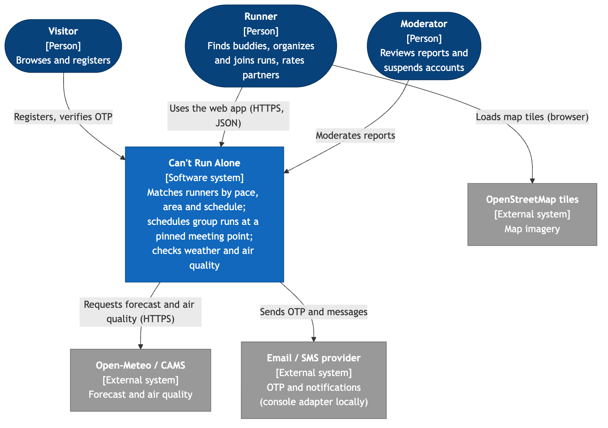
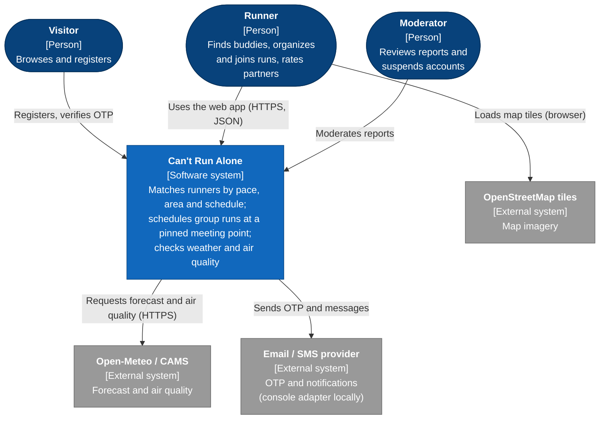

# C4 Level 1: System context

Who uses Can't Run Alone and which external systems it depends on. Arrow convention: **A → B means A starts the interaction.**

## Notes

- A runner can act as an **organizer** (creates a run) or a **participant** (joins one); both are the same account.
- Map tiles are loaded by the browser directly from OpenStreetMap, not through the system ([0011](../adr/0011-render-maps-with-leaflet-and-openstreetmap-tiles.md)).
- The email/SMS provider is replaced by a clearly labeled console adapter in the local deployment; no real SMS is sent.
