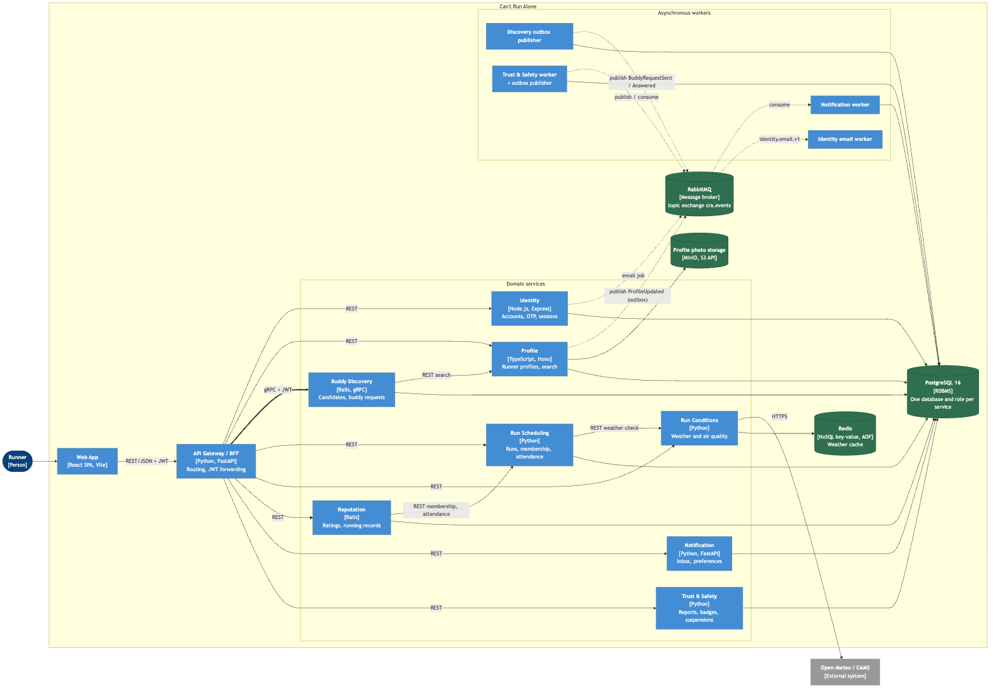
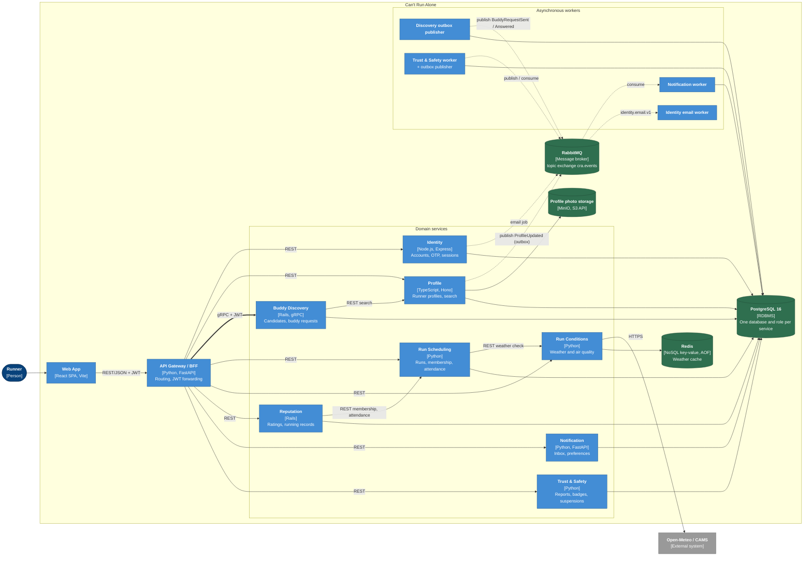

# C4 Level 2: Containers (as built)

The containers that run in the Deliverable 5 stack, checked against `running-buddy-integration/compose.yaml` and `k8s/apps/`. Arrow convention: **A → B means A starts the call.** Responses are not drawn.

Solid arrows are synchronous calls; the thick arrow is the gRPC call; dotted arrows are asynchronous messages through the broker.

## How the course requirements map to containers

| Requirement | Container |
| --- | --- |
| REST service | Reputation, Profile, Run Scheduling, Run Conditions, Notification, Trust &amp; Safety, Identity |
| gRPC service | Buddy Discovery (`buddy_discovery.v1`, port 50051) |
| Message broker service | RabbitMQ: Discovery outbox → Notification worker; Profile publishes `ProfileUpdated`; Trust &amp; Safety; Identity email worker |
| API gateway | API Gateway / BFF (the only container the browser calls) |
| RDBMS | PostgreSQL, one database and owning role per service ([0015](../adr/0015-give-each-service-its-own-postgresql-database.md)) |
| NoSQL | Redis key-value store for weather and air quality, persisted with AOF ([0017](../adr/0017-cache-weather-and-air-quality-in-redis.md)) |
| Service discovery | Platform DNS: Compose service names, Kubernetes Services + CoreDNS (see [`deployment.md`](deployment.md)) |

## Changed since the Deliverable 2 design

[`microservice-architecture.png`](microservice-architecture.png) is the Deliverable 2 **target** design. The build differs in these ways:

- **Buddy Discovery is the gRPC service.** The design gave Discovery a REST API and Run Conditions and Identity gRPC APIs. In the build, the gateway calls Discovery over gRPC, and Conditions and Identity are REST.
- **RabbitMQ, not Kafka.** Domain events go through RabbitMQ with a transactional outbox ([0021](../adr/0021-rabbitmq-for-local-domain-event-delivery.md)).
- **Discovery reads Profile through its API.** Profile already publishes `ProfileUpdated`, but Discovery does not consume it into its own read model yet.
- **Profile and Notification are the team implementations** (since 8 Nov 2026): Profile in TypeScript with photo storage in MinIO, Notification in FastAPI with per-category preferences.
- **No admin console and no email/SMS delivery.** Moderation is an API used by configured moderator accounts; OTPs and emails go to a console adapter.

## Deployment notes

- Docker Compose runs a Python Identity by default; the demo and the Kubernetes deployment use the team's Node.js Identity, selected with `compose.team-identity.yaml`. Both expose the same contract.
- Trust &amp; Safety runs in Compose only; the Kubernetes manifests do not include it yet.
