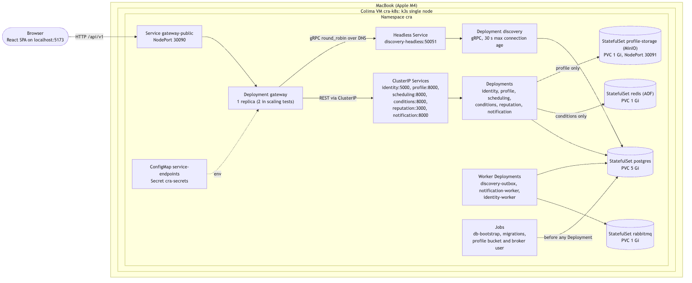
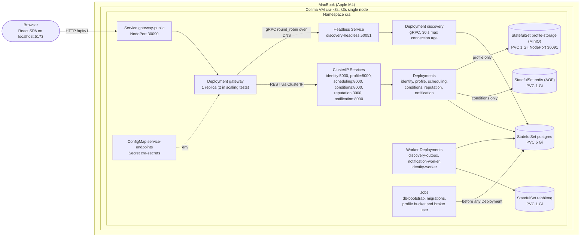

# Deployment overview

How the system is deployed and how its services find each other. The step-by-step procedures live in the integration repository, next to the scripts and manifests:

| Procedure | Where |
| --- | --- |
| Kubernetes (k3s) deployment: cluster, images, secrets, migrations, seed, checks | [`running-buddy-integration/k8s/README.md`](https://github.com/Chula-Com-Sci-2026/running-buddy-integration/blob/main/k8s/README.md) |
| Docker Compose stack used for the live demo | [`running-buddy-integration/README.md`](https://github.com/Chula-Com-Sci-2026/running-buddy-integration/blob/main/README.md) |
| Load tests (k6) against the k3s deployment | [`running-buddy-integration/load-tests/README.md`](https://github.com/Chula-Com-Sci-2026/running-buddy-integration/blob/main/load-tests/README.md) |

## Kubernetes deployment (k3s)

One local k3s node in a dedicated Colima VM (`cra-k8s`, 6 vCPU, 6 GiB), namespace `cra`. Arrow convention: **A → B means A starts the call.**

| Workload | Kind | Service (DNS name:port) | Storage |
| --- | --- | --- | --- |
| postgres | StatefulSet | `postgres:5432` | PVC 5 Gi |
| redis (AOF) | StatefulSet | `redis:6379` | PVC 1 Gi |
| rabbitmq | StatefulSet | `rabbitmq:5672`, `:15672` | PVC 1 Gi |
| identity (team) + identity-worker | Deployment | `identity:5000` | none |
| profile-storage (MinIO) | StatefulSet | `profile-storage:9000`, NodePort `30091` | PVC 1 Gi |
| profile (team, TypeScript), scheduling, conditions, notification (team, FastAPI) (+ worker) | Deployment | `<name>:8000` | none |
| discovery + discovery-outbox | Deployment | `discovery:50051`, `discovery-headless:50051` | none |
| reputation | Deployment | `reputation:3000` | none |
| gateway | Deployment | `gateway:8000`, NodePort `30090` | none |

Trust &amp; Safety is not in the Kubernetes manifests yet; it runs in the Compose stack.

### Deployment process (summary)

From `running-buddy-integration/`:

1. `k8s/scripts/cluster-up.sh`: create or resume the `cra-k8s` VM.
2. `k8s/scripts/build-images.sh`: build every service image into the VM.
3. `k8s/scripts/deploy.sh`: secrets → data stores → `db-bootstrap` Job (one role and database per service) → migration Jobs → applications.
4. `k8s/scripts/seed-demo.sh`: insert the demo accounts and runs.
5. `k8s/scripts/check.sh`: run the business-flow and broker checks inside the cluster.

Readiness probes remove a pod from its Service until its own dependency works; liveness probes are TCP-only so a database outage does not cause restart loops. Every container has CPU and memory requests and limits.

## Docker Compose (live demo)

The live demo runs the same containers with Docker Compose on the presenter's laptop: `docker compose up -d --build`, then the seed script. The gateway is published on `localhost:8088`; databases and internal services are not exposed to the host. See the integration README for the full procedure.

## Service discovery

Callers address a service by **name, never by pod address**, and the platform's DNS resolves it.

- **Compose:** each service name (`profile`, `discovery`, …) resolves on the Compose network.
- **Kubernetes:** `profile` resolves (through the namespace search path) to `profile.cra.svc.cluster.local`, a stable ClusterIP. kube-proxy forwards each new connection to a ready pod listed in the Service's EndpointSlice. When a pod is replaced, the EndpointSlice changes and the name does not.
- **Configuration, not code:** destinations come from the `service-endpoints` ConfigMap (the same variables as Compose), so swapping in a teammate's implementation is a config change and a restart.
- **gRPC needs one more step.** A gRPC channel is a long-lived HTTP/2 connection, so a ClusterIP Service pins every call to one pod. The gateway therefore resolves the headless Service and uses the `round_robin` policy, and Discovery closes connections after 30 s so the gateway re-resolves and picks up new pods.

Measured evidence: pod IPs changed (10.42.0.26/.35 → 10.42.0.37/.38) while `profile` kept resolving to 10.43.28.236, with 0 failed requests. With 2 Discovery pods, calls split 150/150 under `round_robin` versus 300/0 through ClusterIP. Details in [`../quality-attribute-resilience.md`](../quality-attribute-resilience.md).
