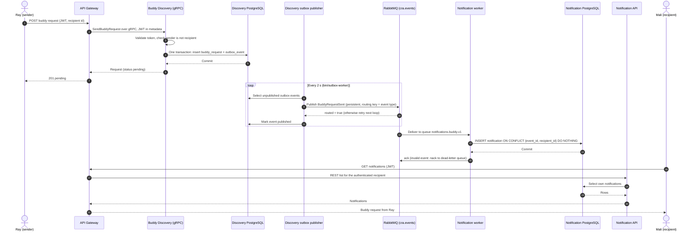

# Sequence: send a buddy request and notify the recipient

Representative business scenario for UC-02 Find a Compatible Running Buddy. It crosses the gateway, the gRPC service, the database, the message broker and a second service. Checked against `buddy-discovery-service` (outbox model and publisher) and `notification-service/worker.py`.

## Why it is built this way

- **Transactional outbox (steps 4–5).** The request and its event commit together, so a broker outage cannot lose the event or leave an event for a request that never existed.
- **The sender does not wait for the broker.** Ray gets an answer as soon as the database commits. If RabbitMQ or Notification is down, the request still succeeds and the notification arrives later (NFR-3.3).
- **At-least-once delivery, idempotent consumer.** The publisher may publish an event twice after a crash; the unique `(event_id, recipient_id)` key stops a duplicate notification. The worker acknowledges only after its commit.
- **Poison messages.** An invalid event is rejected without requeue and goes to the `notifications.dead` queue for inspection.
- **Authorization at every hop.** The gateway forwards Ray's token; Discovery and Notification each validate it and apply their own rules ([0014](../adr/0014-authorize-every-request-in-the-service-that-owns-it.md)).
