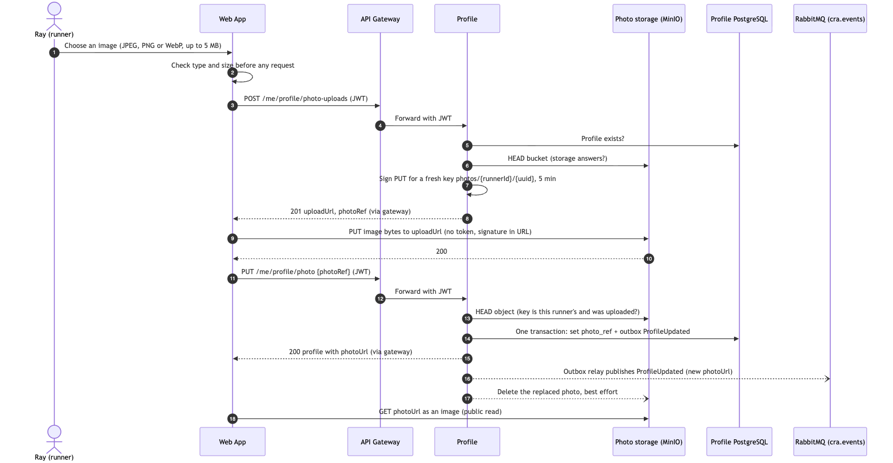
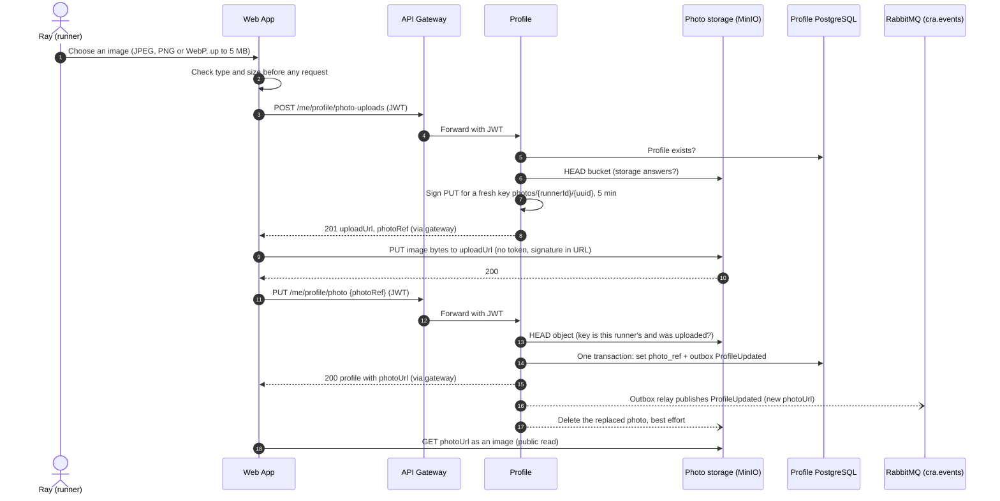

# Sequence: upload a profile photo

How a runner adds a photo to their profile (UC-01 Create a Runner Profile). It is the one flow where the browser talks to something other than the API Gateway: the image goes straight to object storage on a signed URL, so the gateway and Profile only handle small JSON requests. Checked against `profile-service` (`create-photo-upload.ts`, `attach-photo.ts`, `minio-photo-storage.ts`), `api-gateway/app.py` and `cant-run-alone-frontend/src/api/gateway.ts`.

## Why the bytes skip the gateway

- **Gateway and Profile stay small.** They never buffer images, so a large upload cannot tie up the gateway's workers or Profile's memory. Storage is built for that load.
- **The signature is the permission.** The URL works for one key, one method (PUT) and five minutes. Profile checks the key belongs to the caller before attaching it, so a runner cannot adopt another runner's photo.
- **A failed upload leaves no broken image.** The profile only changes in step 14, after storage confirms the object exists. Until then the old photo stays.
- **Storage outages fail early.** Profile asks storage before signing, so an outage is a 503 at step 6 instead of a network error in the browser's upload.

## Deployment detail

The signed URL and `photoUrl` use the storage address the browser can reach: `http://127.0.0.1:9000` in Compose, NodePort `30091` on Kubernetes (see [`deployment.md`](deployment.md)). Profile reaches storage inside the network at `profile-storage:9000`.
